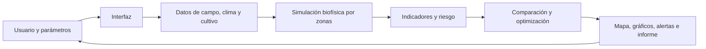

# Guía breve del sistema GDA

## ¿Qué hace?

El Gemelo de Decisión Agronómica (GDA) ayuda a explorar cómo las decisiones de
riego, fertilización y manejo pueden afectar el cultivo de maíz. Para cada zona
estima indicadores como NDVI, estrés hídrico y nutricional y rendimiento; con
ellos presenta alertas y permite comparar alternativas. Es una herramienta de
apoyo a la decisión: no controla equipos de campo ni sustituye la validación de
un agrónomo.

## Lógica general

1. **Configurar:** elegir región, escenario y parámetros de manejo.
2. **Preparar datos:** cargar o generar datos de suelo, clima, cultivo e índices
   de vegetación.
3. **Simular:** avanzar el cultivo día a día y calcular evapotranspiración,
   balance de agua, estrés y rendimiento estimado.
4. **Evaluar:** combinar NDVI, estrés hídrico, estrés nutricional y déficit
   climático para ordenar el riesgo. La configuración usa pesos 35 %, 35 %,
   15 % y 15 % respectivamente; el umbral rojo es 70 %.
5. **Comparar y comunicar:** visualizar zonas y alternativas, revisar
   indicadores y generar un reporte.

En el orquestador de investigación, el ciclo se amplía a
**diseñar escenarios → ejecutar el ABM → analizar resultados y Pareto →
informar hallazgos**.

## Partes principales

| Parte | Responsabilidad | Código representativo |
| --- | --- | --- |
| Interfaz Streamlit | Menú para gemelo, IA, alertas, reportes y asistente | [`app.py`](../app.py), [`modules/`](../modules/) |
| Gemelo y alertas | Simulación por zonas, visualización 3D y evaluación de riesgo | [`modules/gemelo.py`](../modules/gemelo.py) |
| Motor de IA | Exploración de datos, entrenamiento, validación y explicabilidad | [`modules/ia_engine.py`](../modules/ia_engine.py) |
| Dashboard React | Lanzador, progreso, mapa 3D, Pareto e historial | [`frontend/src/pages/GemeloDigital.tsx`](../frontend/src/pages/GemeloDigital.tsx) |
| API de demostración | Atiende al dashboard React y arma el resultado de la demostración | [`backend/main.py`](../backend/main.py), [`backend/api/router.py`](../backend/api/router.py) |
| Persistencia y tareas | Modelos SQLAlchemy y tareas ABM/LangGraph; conexión PostgreSQL o respaldo SQLite | [`backend/app/`](../backend/app/) |
| Orquestador científico | Diseño experimental, ABM, análisis y optimización multiobjetivo | [`caso_estudio.py`](../caso_estudio.py), [`modules/orquestador_langgraph/`](../modules/orquestador_langgraph/) |
| Pipeline reproducible | Auditoría, análisis, pruebas, modelos, calibración, optimización y tablas | [`run_pipeline.py`](../run_pipeline.py), [`pipeline/`](../pipeline/) |
| Flujos visuales | Componentes LangFlow y exportación de flujos a LangGraph | [`integracion_langflow/`](../integracion_langflow/) |

## Demostración breve (2–3 minutos)

1. Abrir el dashboard, comprobar que el backend indique conexión y seleccionar
   **Nueva simulación**.
2. Elegir una región (por ejemplo, `NOROESTE`), dejar el tipo **Simulación ABM**
   y configurar una estrategia de riego y una dosis de nitrógeno.
3. Iniciar el cálculo y observar el avance por fases.
4. Al terminar, mostrar el mapa 3D: cada zona representa una condición diferente;
   comparar su NDVI, estrés y rendimiento, y ubicar las zonas marcadas en rojo.
5. Abrir el frente de Pareto y explicar que cada punto representa una
   alternativa de manejo: mejorar un objetivo (por ejemplo, rendimiento) puede
   aumentar el consumo de agua. Elegir la alternativa adecuada depende de la
   prioridad del productor.
6. Cerrar mostrando el historial. Si también se presenta la interfaz Streamlit,
   abrir **Reportes** y mostrar su exportación como ejemplo de comunicación.

**Guion para exponer:** “Defino una región y un manejo; el sistema evalúa las
zonas del campo, estima su respuesta, identifica posibles riesgos y compara
alternativas. Así puedo explicar no solo qué opción se recomienda, sino también
el intercambio entre rendimiento, agua y otros objetivos”.

## Cómo ejecutar

- **Interfaz Streamlit:** desde la raíz del repositorio, ejecutar
  `streamlit run app.py` y abrir `http://localhost:8501`.
- **Dashboard React de demostración:** en una terminal, ejecutar
  `uvicorn backend.main:app --reload --port 8000`; en otra, desde `frontend/`,
  ejecutar `npm run dev` y abrir la URL que indique Vite (normalmente
  `http://localhost:5173`).
- **Pipeline científico:** desde la raíz, ejecutar `python run_pipeline.py`.
  Es una ejecución por lotes, no una pantalla del dashboard.

## Alcance y lectura de resultados

- El dashboard React usa la API de `backend/api/router.py`, que genera zonas y
  métricas de demostración en memoria; no las persiste como resultados
  agronómicos de producción.
- El gemelo Streamlit genera un conjunto de datos interoperable para su
  visualización y demostración. La aplicación también incluye flujos que pueden
  leer datos y modelos; verificar el origen del dataset antes de interpretar un
  resultado como medición real.
- Existe una API alternativa en `backend/app/` con modelos y persistencia SQL,
  aparte de la API de demostración usada por el dashboard. No se deben asumir
  intercambiables: validar qué servidor y almacenamiento están activos.
- Los resultados solo son apropiados para investigación o demostración hasta
  verificar datos de entrada, configuración, ejecución del modelo y validación
  con observaciones independientes.

## Dónde ampliar

Para instalación y dependencias, consultar [`README.md`](../README.md). Para
ejecutar el orquestador LangGraph, consultar
[`README_orquestador.md`](../README_orquestador.md); para diseñar flujos,
[`LANGFLOW.md`](../LANGFLOW.md).
